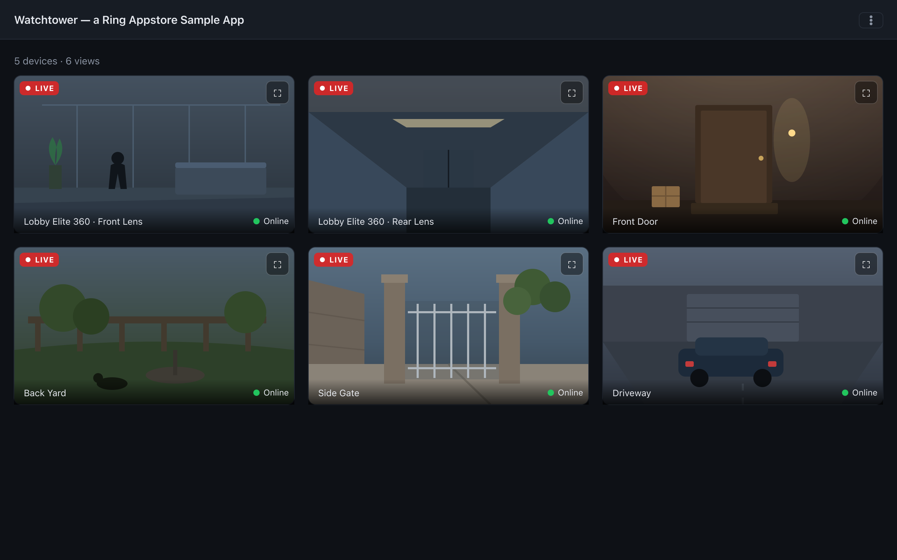
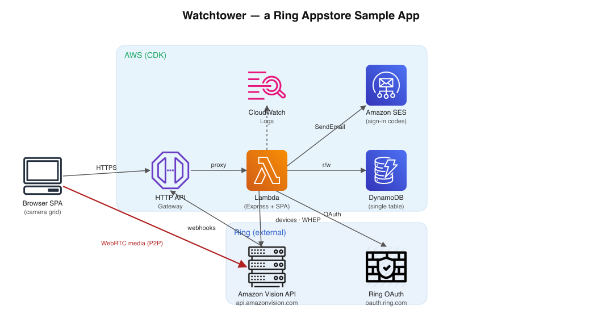
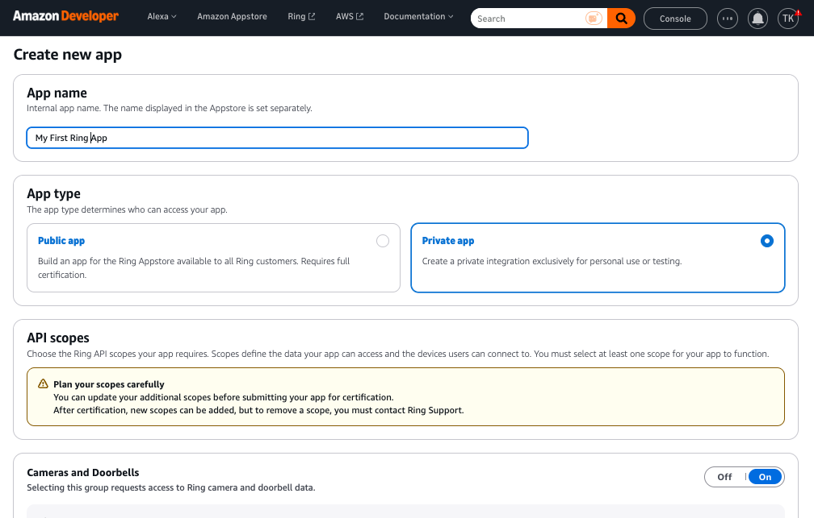
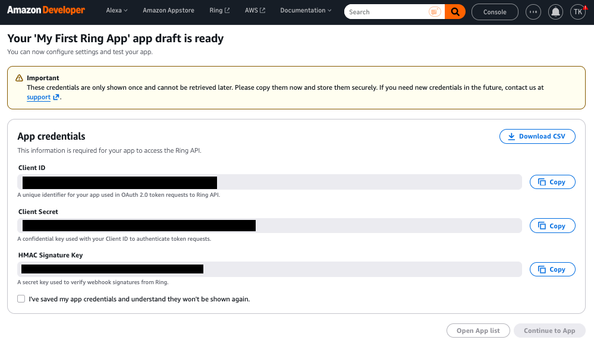
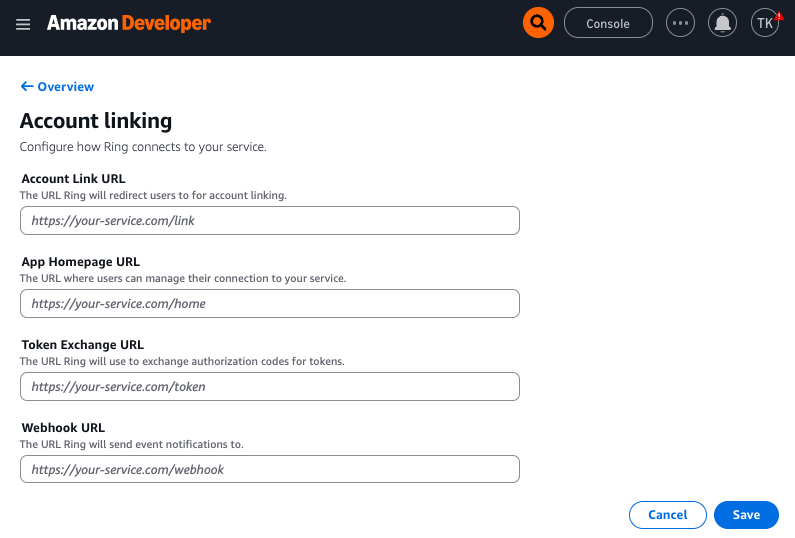
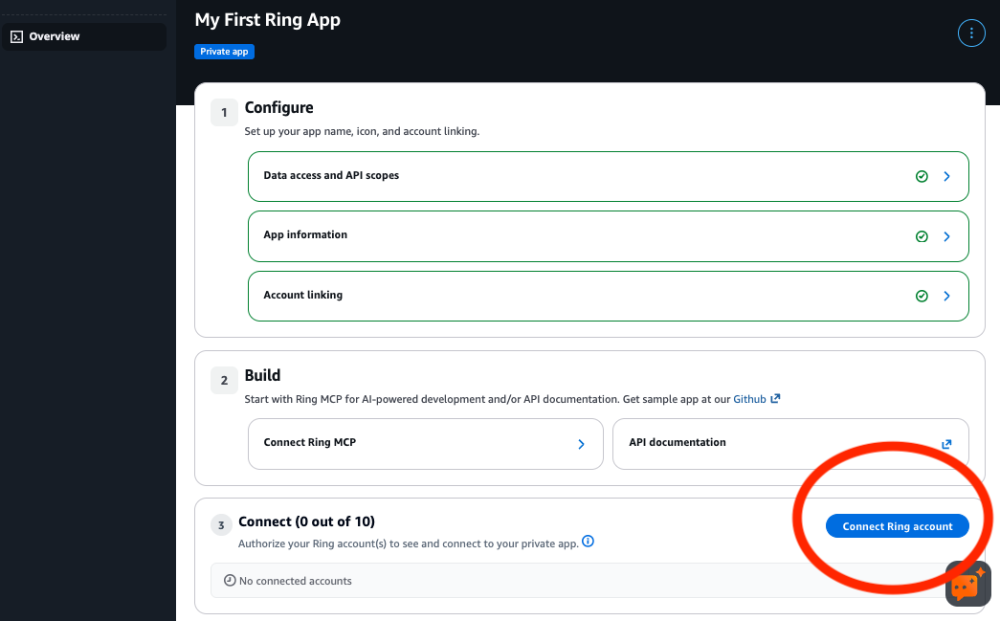
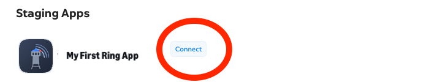

# Watchtower — a Ring Appstore Sample App

**Watchtower** is a minimal, open-source reference app for the **[Ring Appstore](https://developer.ring.com/)** (Amazon Vision API).
It's built for the enterprise and SMB use case of watching **many Ring cameras live on one screen**:
a lobby monitor, a front-desk display, or a small security desk. It links a Ring user's account to
your app, receives Ring webhooks, and shows a live grid of every shared camera in a single page.



*Illustration of the dashboard layout. Camera views are drawn placeholders, not real footage.*

It is intentionally small so you can read it end to end and adapt it to your own deployment. The
whole thing deploys to AWS with one CDK command: **API Gateway → Lambda → DynamoDB**.



## What it does

- **Passwordless account linking**: a customer connects Watchtower from the Ring Appstore and lands on
  a confirmation screen. They never type an email or password to link.
- **Live camera wall**: every shared camera (and each Elite 360 lens) streams live over WebRTC/WHEP.
- **Ring webhooks**: signature-verified, de-duplicated, and used to delete a customer's data when they
  remove the app.
- **Email-code sign-in**: returning customers sign back in with a 6-digit code (Amazon SES).
- **Ring UX guide patterns**: subscription status, a first-visit tutorial, clear offline and error
  states, and in-app account deletion.

For how each piece works, see [How Watchtower works](docs/how-it-works.md).

## What it is NOT

This is a sample. It skips: RTSP, server-side transcoding, analytics, clip downloads, and 360-panorama
stitching (Elite 360 lenses are shown as separate live tiles, not stitched into one panorama). For auth
it uses a **signed, httpOnly session cookie** (set at login, verified on every API route) — a minimal
but real session mechanism, not a production identity system. For production you'd likely add CSRF
tokens, token rotation, and a revocation/session store (see [Going to production](docs/how-it-works.md#going-to-production)).
Add what you need.

## Project layout

| Path         | What's inside                                                        |
|--------------|----------------------------------------------------------------------|
| `backend/`   | The Lambda: an Express app wrapped by `serverless-express`.           |
| `frontend/`  | The single-page camera grid (Vite + vanilla JS, no framework).        |
| `infra/`     | AWS CDK stack: HTTP API Gateway, Lambda, one DynamoDB table.          |

## Prerequisites

- Node.js 22+ (the Lambda runs on Node.js 22)
- Works on macOS, Linux, and Windows. On Windows, run the commands below in **PowerShell** (or Git
  Bash); where a shell command differs by platform, both variants are shown.
- An AWS account and credentials (`aws configure` or `AWS_PROFILE`)
- [AWS CDK v2](https://docs.aws.amazon.com/cdk/v2/guide/getting_started.html). You don't need to
  install it: the project includes the CDK CLI, and step 5 runs it for you.
- Ring Developer credentials: **Client ID**, **Client Secret**, **HMAC Signing Key**
  (from the [Ring Developer Console](https://developer.amazon.com/ring/console/apps); see
  [developer.ring.com](https://developer.ring.com/) to get started)
- An **Amazon SES verified identity** (an email address or domain) for sending sign-in codes. Set it
  as `SES_FROM_EMAIL`. For the sample, verifying a single address is enough, just note that while
  your SES account is in the **sandbox**, codes only deliver to *verified* recipient addresses. See
  [Going to production](docs/how-it-works.md#going-to-production) before relying on this for real users.

The steps below go in order: create the app on the Ring Developer Portal first (you need its
credentials to configure the backend), deploy to AWS, then wire the deployed URLs back into the
portal and link a camera. You need a deployed endpoint to test end to end, because the Ring Appstore
drives account linking over public HTTPS and will not call back to `localhost`.

> **Local UI iteration.** After you've deployed and linked once, `npm run dev` runs the backend on
> `localhost:3000` and the Vite dev server on `localhost:5173` (proxying `/api` to the backend),
> using the same `.env`. It's for working on the dashboard: account linking and webhooks still need
> the deployed URLs.

## 1. Create a new app on the Ring Developer Portal

Sign in to the [Ring Developer Console](https://developer.amazon.com/ring/console/apps) and create a
new app for the **Ring Appstore (Amazon Vision API)**. Give it a name and the basic details; you'll
fill in the account-linking URLs later (step 6), after you have a deployed endpoint.



## 2. Capture credentials

From your new app, copy the three secrets the backend needs:

- **Client ID** (`RING_CLIENT_ID`)
- **Client Secret** (`RING_CLIENT_SECRET`)
- **HMAC Signing Key** (`RING_HMAC_SIGNING_KEY`)

Keep these somewhere safe; you'll paste them into `.env` in the next step. Treat the secret and the
signing key like passwords; never commit them.



## 3. Configure

First, clone this project and change into the project directory. The commands in this and the
following steps are all run from the project root:

```bash
git clone https://github.com/AmazonAppDev/ring-appstore-watchtower-sample.git
cd ring-appstore-watchtower-sample
```

Then create your `.env` from the example and fill in the credentials from step 2:

```bash
# macOS / Linux
cp .env.example .env
```

```powershell
# Windows (PowerShell)
Copy-Item .env.example .env
```

Then edit `.env` and fill in `RING_CLIENT_ID`, `RING_CLIENT_SECRET`, `RING_HMAC_SIGNING_KEY`, and
`SES_FROM_EMAIL` (a verified SES sender address). The deploy stops with a clear message if any of
them is still the example value.

## 4. Install

From the project directory you cloned in step 3, install all workspace dependencies:

```bash
npm install          # installs root + backend + frontend + infra workspaces
```

## 5. Deploy to AWS

If you've never used the AWS CDK in this AWS account and region, bootstrap it once (this creates
the resources CDK uses to deploy, such as an S3 bucket for the Lambda code):

```bash
npm run bootstrap    # once per AWS account and region
```

Then deploy:

```bash
npm run deploy
```

CDK provisions the table, the Lambda (with your Ring secrets as environment variables), and an HTTP
API Gateway, then prints four stack outputs, one per field on the Ring Developer Portal
**Account linking** form (you'll use these in the next step):

| Ring Developer Portal field | CDK output         | Value                               |
|-----------------------------|--------------------|-------------------------------------|
| Account Link URL            | `AccountLinkUrl`   | `https://<api-url>/ring/link`       |
| App Homepage URL            | `AppHomepageUrl`   | `https://<api-url>`                 |
| Token Exchange URL          | `TokenExchangeUrl` | `https://<api-url>/oauth/token`     |
| Webhook URL                 | `WebhookUrl`       | `https://<api-url>/webhooks/ring`   |

> The frontend is served by the same Lambda (static files bundled into the deployment) so the whole
> app lives behind one URL. The dashboard (and the App Homepage URL) is `https://<api-url>/`.

## 6. Add the deployed endpoints to Account linking

Back in the Developer Portal, open your app's **Account linking** page and paste each stack output
into the matching field (the fields appear in the same order as the table above), then **Save**:



## 7. Add your Ring user as a test user

While the app is in development it isn't public, so add the Ring account you'll test with as a
**test user** for your app. Use the email of the Ring account whose cameras you want to view.



## 8. Initiate account linking from the Ring Appstore

As that test user, open the **[Ring Appstore](https://ring.com/appstore)** (in the Ring app), find your app, and start the
install / connect flow. Pick the cameras you want to share. Ring then runs the passwordless link
(token exchange → redirect to your Account Link URL), and your app auto-provisions the account.



## 9. Confirm the dashboard shows your camera feed

After linking, you land on the dashboard at `https://<api-url>/`. Each shared camera appears as a
live tile (Elite 360 cameras show one tile per lens). You now have your Ring cameras streaming on a
single screen.


## Tear it down

To remove all AWS resources this stack created, including the DynamoDB table (with every linked
account's tokens) and the Lambda's logs:

```bash
npm run destroy
```

Then remove the app's URLs from the Ring Developer Portal, or delete the app there. The CDK
bootstrap resources from step 5 stay in your account; they're shared by any CDK project.

## Something not working?

See [Troubleshooting](docs/how-it-works.md#troubleshooting) for common setup and deploy issues and
their fixes. The backend logs linking, webhook, and streaming errors to CloudWatch Logs (log group
`/watchtower-sample/api`, kept for 30 days).

## Learn more

[docs/how-it-works.md](docs/how-it-works.md) covers the details:

- [How account linking works](docs/how-it-works.md#how-account-linking-works-passwordless-one-way),
  [sign-in](docs/how-it-works.md#how-dashboard-sign-in-works-email-code-via-ses),
  [live streaming](docs/how-it-works.md#how-live-streaming-works-whep),
  [token refresh](docs/how-it-works.md#how-token-refresh-works) and
  [webhooks](docs/how-it-works.md#how-webhooks-are-handled)
- The [DynamoDB schema](docs/how-it-works.md#dynamodb-schema-single-table) and
  [security notes](docs/how-it-works.md#security-notes)
- How it follows the [Ring UX design guide](docs/how-it-works.md#ring-ux-design-guide-compliance)
- [Troubleshooting](docs/how-it-works.md#troubleshooting) common setup and deploy issues
- [Going to production](docs/how-it-works.md#going-to-production): what to change before real
  customers use an app like this

## Privacy

[PRIVACY.md](./PRIVACY.md) is a privacy policy template that describes exactly what this sample
collects, why, who it's shared with, how long it's kept, and how customers delete their data or
withdraw consent. If you publish an app based on Watchtower, adapt it, have it reviewed, and link it
from your Ring Appstore listing (Ring requires a privacy policy link on the listing).

## License

MIT-0 (MIT No Attribution). See [LICENSE](./LICENSE).
