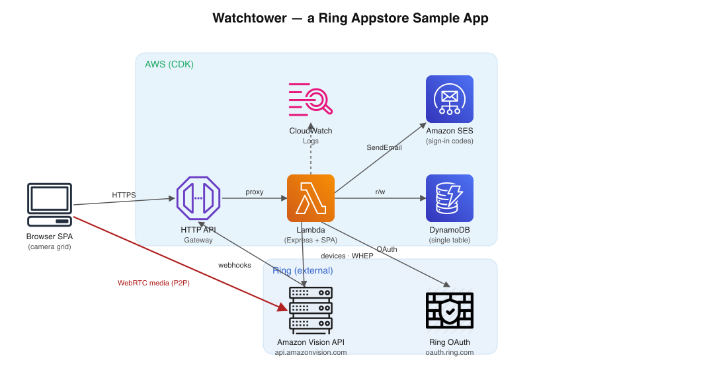

# How Watchtower works

The details behind the [README](../README.md): troubleshooting, how each part of the sample works, the data it
stores, how it follows the Ring UX design guide, and what to change before real customers use an app
like this. To deploy the sample, start with the README.

## Troubleshooting

| Symptom | Likely cause | Fix |
|---|---|---|
| `npm run deploy` fails with `This stack uses assets… requires bootstrapping` | The target AWS account/region hasn't been CDK-bootstrapped. | Run `npm run bootstrap` once ([step 5](../README.md#5-deploy-to-aws)), then redeploy. |
| Deploy throws `... is still the example value from .env.example` | `.env` still has a value from `.env.example`. | Replace it as described in [step 3](../README.md#3-configure), then redeploy. |
| Deploy throws `Missing RING_CLIENT_ID` (or another var) | `.env` isn't filled in. | Create `.env` from the example (`cp .env.example .env`, or `Copy-Item .env.example .env` on Windows) and set `RING_CLIENT_ID`, `RING_CLIENT_SECRET`, `RING_HMAC_SIGNING_KEY`, `SES_FROM_EMAIL`. |
| Sign-in code email never arrives | SES is in the **sandbox**, which only delivers to verified recipients, or `SES_FROM_EMAIL` isn't verified. | Verify both the sender and the recipient in the SES console, or request SES production access. See [Going to production](#going-to-production). |
| Account linking fails / "This link is missing information" | The Account Link / Token Exchange URLs in the Developer Portal don't match the deployed endpoints, or the HMAC signing key differs. | Re-copy the four stack outputs into the portal ([step 6](../README.md#6-add-the-deployed-endpoints-to-account-linking)) and confirm `RING_HMAC_SIGNING_KEY` matches your app's signing key. |
| Camera tiles say "Live view isn't available right now" or stay connecting | The camera is offline, the browser blocked WebRTC, or Ring rate-limited the WHEP handshake. | Check the device is online in the Ring app, try the tile's **Reconnect** button, and confirm the browser allows WebRTC (no blocking extension/VPN). |
| Webhook calls return 401 | The `X-Signature` HMAC didn't verify (wrong signing key, or a proxy altered the raw body). | Ensure `RING_HMAC_SIGNING_KEY` matches the portal and that nothing re-encodes the request body before it reaches the Lambda. |
| Dashboard loads but shows "No Ring devices connected yet" | No cameras were shared during linking, or the session user has no claimed token. | Re-run the link flow from the Ring Appstore and pick the cameras you want to share. |
| "Unable to validate URL" when saving the Token Exchange / Webhook URL in the portal | The portal probes each URL (a GET) to confirm it resolves before saving, and the URL isn't reachable. | Confirm you pasted the exact deployed URL (from the `npm run deploy` outputs) and that the stack is deployed. These endpoints answer the GET probe with 200; a 404 usually means a typo or a stale URL from a previous deploy. |
| `npm audit` reports a moderate `minimatch` advisory | It's bundled inside `aws-cdk-lib`, which is used only to deploy (see [A note on `npm audit`](#a-note-on-npm-audit)). | Safe to ignore for this sample; it never reaches the deployed Lambda or the browser. Update `aws-cdk-lib` when AWS ships a fix. |
| Dashboard says "Reconnect Watchtower to Ring" | Watchtower was removed in Ring My Apps, or the link expired after about 30 days without use (this sample refreshes tokens only when the dashboard is open). | Add Watchtower again from the Ring Appstore in the Ring app. |

For anything deeper, check the Lambda's **CloudWatch Logs** (log group `/watchtower-sample/api`); the backend logs linking, webhook, and streaming errors there. Logs are kept for 30 days.

## Architecture

```
┌──────────────┐      HTTPS       ┌───────────────┐     ┌────────────┐
│  Browser SPA │ ───────────────▶ │  API Gateway  │ ──▶ │   Lambda   │
│ (camera grid)│ ◀─ SDP answer ── │  (HTTP API)   │     │  (Express) │
└──────┬───────┘                  └───────────────┘     └─────┬──────┘
       │                                                      │
       │ WebRTC/WHEP media (peer ⇄ Ring)                      │ Bearer token
       ▼                                                      ▼
┌──────────────────────┐                           ┌────────────────────┐
│  Ring Amazon Vision   │ ◀── token refresh ─────── │   DynamoDB (one     │
│  api.amazonvision.com │ ─── webhooks ───────────▶ │   single table)     │
└──────────────────────┘                           └────────────────────┘
```



## Who it's for (developer story)

> **As a** developer building on the Ring Appstore (Amazon Vision API),
> **I want** a small, complete reference app that links a Ring account, receives webhooks, and streams
> every shared camera live on one screen,
> **so that** I can see exactly how the account-linking, webhook, and WHEP streaming pieces fit
> together and adapt them to my own multi-camera monitoring product.

The target use case is an enterprise/SMB **wall of cameras** (a lobby monitor, a front-desk display,
or a small security desk) rather than a single-camera consumer view.

### What this sample proves

- [x] A developer can deploy the whole stack to AWS with a single command (`npm run deploy`).
- [x] The deploy prints the four URLs needed for the Ring Developer Portal **Account linking** form.
- [x] A Ring user links their account **passwordlessly** (no form, no password), driven entirely by
      Ring's redirect, with the email read from the Ring User Data API.
- [x] After linking, the user sees a confirmation screen listing their connected devices, then a live
      grid where every shared camera (and every Elite 360 lens) plays as a low-latency WHEP stream.
- [x] A returning user signs back in with a 6-digit email code (Amazon SES), still passwordless.
- [x] Incoming Ring webhooks are signature-verified over the raw request bytes and acknowledged within
      the 5-second window.
- [x] Online/offline state is conveyed with **both** a text label and a color (never color alone), and
      offline cameras are shown dimmed with an explanation rather than hidden.
- [x] The user can delete their Watchtower account and data from within the app.

## Features in detail

- **Passwordless account linking (one-way / Ring-driven)**: Ring POSTs an auth code to your Token
  Exchange URL, then redirects the user to your Account Link URL with an HMAC nonce. The app exchanges
  the code, reads the user's **email from the Ring User Data API** (`GET /v1/users/me`), matches the
  nonce, auto-provisions the user (no password), and finalizes the link with Ring (`POST` + `PATCH
  /v1/accounts/me/app-integrations`). The user never types anything to link.
- **Passwordless dashboard sign-in (email code via SES)**: after signing out, a returning user enters
  their email and receives a 6-digit code by email (Amazon SES). Entering the code signs them back in.
- **Webhooks**: a signed `POST /webhooks/ring` endpoint that verifies the `X-Signature` HMAC,
  de-dupes deliveries in DynamoDB, answers within 5 seconds, and deletes the customer's data when they
  remove the app (`app_integration_removed`).
- **Live camera grid**: lists the shared devices (`GET /v1/devices`) and plays each one as a
  low-latency WebRTC stream using Ring's WHEP endpoint, proxied through the Lambda. Each tile has a
  fullscreen button, and a top-right dropdown shows the customer's **subscription/trial status**
  (Subscriptions Query API) and lists every camera (and every lens) with its product image from
  Ring and an online/offline indicator, plus a "How this works" tutorial replay, Sign out, and
  account deletion.
- **Subscription & trial status**: `GET /api/subscription` calls the Ring Subscriptions Query API
  (`GET /v1/accounts/me/subscriptions`) and summarizes active paid plans and trials in the dropdown.
- **Elite 360 multi-lens**: cameras that expose multiple lenses (`capabilities.components.items`) are
  rendered as one live tile per lens, each streamed with its own WHEP session targeting the lens via a
  `component_id` query parameter.

## How account linking works (passwordless, one-way)

1. User installs your app in the Ring Appstore and picks devices.
2. Ring `POST`s an authorization code to **`/oauth/token`** (form-encoded). The backend exchanges it
   at `https://oauth.ring.com/oauth/token`, calls the Ring **User Data API** `GET /v1/users/me` for the
   `account_id` **and the user's email**, and stores the token as **unclaimed** (keyed by `account_id`,
   15-minute TTL) with the email cached on it.
3. Ring redirects the user to **`/ring/link?nonce=…&time=…`**. The backend checks the timestamp is
   fresh (< 600s) and forwards the user to the SPA, which **auto-finalizes** with no form to fill in.
4. The SPA calls **`POST /api/link`** with just the `nonce` and `time` (no email, no password).
   This endpoint checks the `time` freshness window again (Ring requires it everywhere `nonce` and
   `time` are used), and ignores unclaimed tokens past their TTL, since DynamoDB deletes expired
   items lazily.
5. The backend recomputes `HMAC-SHA256(key, "<time>:<account_id>")` for each unclaimed token and
   constant-time compares it to the nonce to find the right account.
6. It reads the Ring-provided email, **auto-provisions the user** (`emailVerified: true`, no password),
   calls `POST /v1/accounts/me/app-integrations` (nonce verify) then `PATCH … {status:"completed"}` to
   finalize, promotes the token to **claimed** (keyed by your user id), and the user lands on the grid.
   The `account_identifier` sent to Ring is the **masked** email (`u***r@example.com`), per Ring's
   App Integrations best practices; Ring identifies the account from the Bearer token.

If the token exchange (step 2) fails, `/oauth/token` answers **502**, never a misleading 200.

## How dashboard sign-in works (email code via SES)

Account linking establishes the user. After they sign out, they sign back in with an email code: no
password, no second Ring round-trip:

1. On the sign-in screen the user enters their email; the SPA calls **`POST /api/auth/send-code`**.
2. The backend looks up the linked user, generates a 6-digit code, stores it in DynamoDB
   (`PASSCODE#<email>` / `CODE`, 10-minute expiry + TTL cleanup, max 5 attempts), and e-mails it with
   **Amazon SES** from `SES_FROM_EMAIL`. A new code is sent at most once a minute per email. (Unknown
   emails, and requests inside the cooldown, get the same `sent` response, so the endpoint doesn't
   reveal which emails have accounts.)
3. The user enters the code; the SPA calls **`POST /api/auth/verify-code`**. The backend constant-time
   compares it, deletes the single-use code, and sets the signed, httpOnly session cookie (the user
   id is never returned to the browser), landing the user on the grid.

## How live streaming works (WHEP)

The browser creates a `recvonly` WebRTC offer and sends the SDP to **`POST /api/devices/:id/stream`**.
The Lambda forwards it (with the user's bearer token) to Ring's WHEP endpoint
`POST /v1/devices/:id/media/streaming/whep/sessions`, and returns the SDP answer. Media flows
peer-to-peer between the browser and Ring. On teardown the browser calls **`DELETE /api/stream`** so
the Lambda closes the Ring session (important for battery-powered cameras). The Lambda only accepts
Ring's session URL here (`https://api.amazonvision.com/v1/devices/{id}/media/streaming/whep/sessions/{id}`,
plus whatever query string Ring adds, such as `?location=…`), because the URL comes back from the
browser and gets the user's Ring token attached.

If Ring rate-limits a stream (`429`), the tile waits for Ring's `Retry-After` (or 1s, doubling, up
to 60s) before trying again. If Ring rejects the access token (`401`), the backend refreshes it and
retries once. If the link itself is gone (refresh rejected, or Watchtower removed in Ring My Apps),
the dashboard shows **"Reconnect Watchtower to Ring"** instead of a generic error.

> **Battery-powered cameras.** Watchtower streams every shared camera for as long as the dashboard is
> open. That's the point of a video wall, but it drains battery cameras quickly, and Ring caps live
> session length by power source. For battery devices, consider streaming on demand (click to play)
> or pausing streams for tiles that aren't visible.

## How token refresh works

Access tokens last about 4 hours. `getValidToken` refreshes one when it's within 5 minutes of
expiry, or when Ring has just rejected it (401). Ring **rotates refresh tokens**: each refresh
returns a new one and invalidates the one used. That matters here, because opening the dashboard
sends a request per camera at the same moment. If each one refreshed, only the first would succeed
and the rest would fail with `invalid_grant`, which looks like a broken link.

So refreshes are serialized per customer:

1. One request takes a short lock: a conditional put on `REFRESHLOCK#<userId>` with a 10-second
   lease, so a crashed holder can't block anyone for long.
2. Inside the lock it re-reads the token (another request may have just refreshed it), calls Ring,
   and saves the new pair with a **conditional write** (`refreshToken = <the one used>`), so a stale
   write can never overwrite a newer pair.
3. The other requests wait for the stored token to change, then use it. If they wait more than
   8 seconds, they answer with a temporary 503 instead of a "reconnect" prompt.

Within one process, concurrent calls also share a single in-flight refresh.

## How webhooks are handled

`POST /webhooks/ring` verifies the signature, then records `meta.request_id` with a DynamoDB
conditional put, so a duplicate delivery is skipped even across Lambda instances. The event is
handled **before** the 200 response: on Lambda, work scheduled after responding may never run. It's
a few small DynamoDB calls, well inside Ring's 5-second limit. If handling fails, the request_id is
released and the endpoint answers 500 so Ring retries.

On **`app_integration_removed`** (the customer removed Watchtower in Ring My Apps), Ring has already
revoked the tokens, so the handler deletes everything Watchtower stores for that customer: the
claimed token, the user record, any sign-in code, and any unclaimed token. Other events are logged
only.

## DynamoDB schema (single table)

| Entity           | PK                     | SK      | Notes                                  |
|------------------|------------------------|---------|----------------------------------------|
| Unclaimed token  | `UNCLAIMED#<accountId>`| `TOKEN` | `status=UNCLAIMED`, 15-min TTL         |
| Claimed token    | `USER#<userId>`        | `TOKEN` | `status=CLAIMED`                       |
| App user         | `EMAIL#<email>`        | `USER`  | your side of the link                  |
| Sign-in code     | `PASSCODE#<email>`     | `CODE`  | 6-digit code, 10-min expiry + TTL      |
| Webhook seen     | `WEBHOOK#<request_id>` | `SEEN`  | dedupe record, 24-hour TTL             |
| Refresh lock     | `REFRESHLOCK#<userId>` | `LOCK`  | 10-second lease while a token refreshes |

A GSI named `StatusIndex` (partition key `status`) lets the linking step scan unclaimed tokens, and
lets the `app_integration_removed` webhook find a customer's claimed token by Ring account ID.

## Security notes

- Webhook signatures are verified over the **raw request bytes** before any processing.
- Nonces are compared with `crypto.timingSafeEqual` (constant time).
- Dashboard API routes require a **signed, httpOnly session cookie** (HMAC-signed with a key derived
  from `RING_CLIENT_SECRET`, or with `SESSION_SECRET` if you set one; set at login, verified
  server-side on every `/api` route). The cookie is `httpOnly` + `Secure` so it
  isn't readable by JavaScript, and its signature is checked constant-time — a client can't forge a
  session or impersonate another user by supplying an id.
- Access tokens auto-refresh (5-minute buffer) via the refresh token.
- Every request to `api.amazonvision.com` and `oauth.ring.com` sends Ring's **required headers**
  (API Reference): `User-Agent: Watchtower/<version>` and `Hardware_Id`, a UUID that's stable for
  each customer (a name-based UUID derived from their Ring account ID, so nothing extra is stored).
  Calls made before the account ID is known use an app-level ID. Ring's firewall may answer
  requests without these headers with `406 Not Acceptable`. If you fork this app, change the
  `User-Agent` name in `backend/src/ringClient.js`.
- Ring secrets live only in Lambda environment variables / your local `.env`;
  never commit `.env`.

## Ring UX design guide compliance

This sample follows Amazon's
[App Design Guide for Ring Customer Experiences](https://developer.amazon.com/docs/ring/ux-design-guide.html).
What it implements:

- **Passwordless account linking** (the guide's recommended, lowest-friction pattern): the email comes
  from the Ring User Data API, the user is auto-provisioned, no form or password.
- **Account linking confirmation screen**: after linking, the app shows an "Account linked" screen
  listing connected devices with online/offline status and a "Go to dashboard" button, rather than
  dropping the user straight into the app.
- **No verification during linking**: email codes are only used for later dashboard sign-in, never as
  a blocking step in the link flow.
- **Devices by name, never by ID**; **online/offline status with a dot *and* a text label** (color is
  never the only signal).
- **Offline devices are shown dimmed with guidance** ("Check its power and Wi-Fi in the Ring app"),
  not hidden.
- **Plain-language errors with a next step**: an expired link, a failed link, and a link that has
  ended ("Reconnect Watchtower to Ring") each explain what happened and where to fix it.
- **Helpful empty state** directing the customer to add the app from the Ring Appstore, kept
  distinct from a **"couldn't load" error state** (which offers a retry) so the two are never confused.
- **First-visit tutorial**: a short, skippable walkthrough shown once on the first dashboard visit,
  replayable any time via the menu's "How this works" item.
- **Subscription & trial status**: the menu shows the customer's paid-subscription / trial state
  (via the Subscriptions Query API), including trial days remaining, and points to **Ring My Apps**
  for managing the plan (and notes that a trial continues as a paid plan when it ends if
  auto-renewal is on).
- **Silent token refresh**; tokens and internal IDs are never shown to the customer.
- **In-app data deletion**: "Delete my account & data" in the menu deletes the stored token, user
  record and any pending sign-in code (Watchtower data only; it doesn't touch the Ring account). The
  confirmation says exactly what's deleted and that removing Watchtower in Ring My Apps is what ends
  camera access, since one-way-linked apps can't revoke it themselves.
- **Accessibility (WCAG 2.2 AA intent)**: text labels alongside color, `prefers-reduced-motion`
  support (the LIVE pulse stops), visible keyboard focus, Escape-to-close menu, image `alt`/aria labels.
  Full WCAG conformance still requires manual testing with assistive technologies.

Intentionally **out of scope** for a minimal sample (add these for a real app; see the guide):
Smart Alerts / motion-zone configuration guidance messages, live `device_removed` webhook-driven UI
updates, an activity history view, and proactive engagement (daily summaries / notification
preferences).

## Going to production

This is a **sample**, optimized to be read and deployed quickly. Before you put something like it in
front of real users, work through these:

- **Amazon SES: leave the sandbox.** New SES accounts are in the **sandbox**, which only delivers to
  *verified* recipient addresses, so the email sign-in code only reaches addresses you've verified.
  Request **production access** in the SES console to email arbitrary users, and verify a **domain**
  identity (with DKIM) for `SES_FROM_EMAIL` rather than a single address. Watch your bounce/complaint
  rates. Consider SESv2 and a configuration set for event tracking.
- **Sessions / auth.** The dashboard uses a **signed, httpOnly, Secure session cookie** (HMAC-signed
  with a key derived from `RING_CLIENT_SECRET`, set at login and verified server-side on every `/api`
  route via a single `requireUser` chokepoint). That's a real, if minimal, session: the cookie can't be read by JS or
  forged by a client. For production, harden it further — add **CSRF protection** (the cookie uses
  `SameSite=Lax` as a baseline; add CSRF tokens for state-changing requests), rotate/short-expire the
  token, and keep a **server-side session/revocation store** so you can invalidate sessions. A signed
  JWT is a fine alternative to the HMAC cookie. To sign everyone out on demand, set your own
  `SESSION_SECRET` (at least 32 random characters) and change it when needed; the derived key never
  changes because the Ring client secret can't be rotated. Store it in Secrets Manager (see below).
- **Sign-in code hardening.** Codes are 6 digits with a 10-minute expiry, a 5-attempt cap per code,
  and a one-minute resend cooldown per email. For production also add **per-IP rate limiting** (for
  example, API Gateway throttling or AWS WAF) and consider a longer code or lockout/backoff.
- **IAM least privilege.** The Lambda's SES policy uses `Resource: "*"`. Scope it to your verified SES
  identity ARN, and review the DynamoDB grant. Nothing here should run with broad permissions.
- **Webhook processing.** Events are de-duped in DynamoDB and handled before the 200 response,
  which is fine for the few fast DynamoDB calls here. If you add slow work (notifications, video
  analysis), put events on a queue such as **SQS** with a dead-letter queue and process them there.
- **Secrets management.** Ring secrets are passed as **plaintext Lambda environment variables**. For
  production, store them in **AWS Secrets Manager** (or SSM Parameter Store with KMS) and load them at
  runtime, so they're encrypted at rest and auditable. Never commit `.env`.
- **Proactive token refresh.** This sample refreshes a customer's access token only on demand, when
  they open the dashboard (`getValidToken`, 5-minute buffer). Ring refresh tokens expire after about
  **30 days without use**, so a customer who doesn't open the app for a month has to re-link from the
  Ring app. Ring requires production apps to refresh proactively: add a scheduled job (for example,
  an EventBridge rule that runs daily) that refreshes every linked customer's token through the same
  `getValidToken` path, so it shares the per-customer refresh lock described in
  [How token refresh works](#how-token-refresh-works). See Ring's *Refresh Tokens* guide.
- **Token storage.** OAuth access/refresh tokens are stored in DynamoDB. Enable **encryption at rest**
  with a customer-managed KMS key, restrict table access, and set `RemovalPolicy.RETAIN` (this sample
  uses `DESTROY` so `cdk destroy` cleans up).
- **CORS.** The API sends no CORS headers because the SPA and API are same-origin. If you move the
  frontend to a separate origin, allow exactly that origin (with credentials), never all origins.
- **Observability & limits.** The backend already writes structured JSON logs. Add metrics and
  **CloudWatch alarms** (for example, a metric filter on `"refresh token rejected"` or
  `"webhook processing error"` log lines that alerts you), and request throttling on API Gateway.

## A note on `npm audit`

The backend and frontend have no known vulnerabilities. `npm audit` may still flag a moderate
`minimatch` advisory: it's bundled inside `aws-cdk-lib` (used only to deploy, never in the Lambda or
the browser), so it can't be patched here. Updating `aws-cdk-lib` picks up the fix once AWS ships it.

## Readiness checklist exceptions

[`.ring-readiness.json`](../.ring-readiness.json) records the checks this sample intentionally
doesn't implement, with the reason and where the gap is documented. Right now that's the scheduled
token refresh job (TOK-02); see [Going to production](#going-to-production). A real app should
implement them rather than copy this file.
